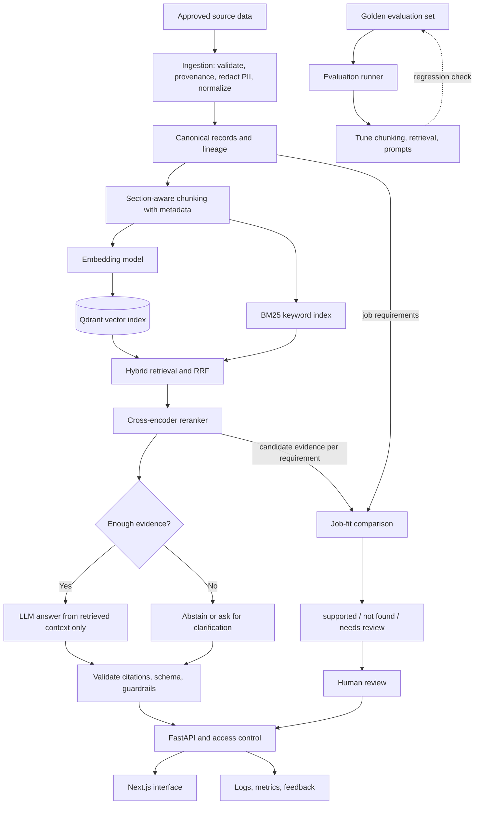

# Architecture

This document describes the planned design. Nothing here is implemented yet. It follows the flow diagram in the README, with one change described in section 2.

## 1. Components

| Component | Purpose | Input | Output | Stage |
|---|---|---|---|---|
| Data contracts (`data/`) | Define the record types and check them | Raw records | Validated records or a rejection reason | 02 |
| Ingestion (`ingestion/`) | Validate, record provenance, redact PII, normalize, chunk | Source files, settings | Canonical records, chunks with metadata, index manifest | 04 |
| Embedding provider (`core/`) | Turn text into vectors | Text list | Vector list | 05 |
| Vector index (Qdrant) | Store vectors and metadata, search by similarity with filters | Chunks plus vectors, query vector, filter | Ranked chunk IDs | 05 |
| Keyword index (BM25) | Exact-term search for skill names and acronyms | Chunks, query text, filter | Ranked chunk IDs | 06 |
| Fusion (`retrieval/`) | Merge the two ranked lists with reciprocal rank fusion | Two ranked lists | One ranked list | 06 |
| Reranker (`retrieval/`) | Re-score a small pool with a cross-encoder | Query, candidate chunks | Re-ordered chunks with scores | 06 |
| Evidence gate (`generation/`) | Decide whether the evidence is enough to answer | Reranked chunks, query | Answer or abstain decision | 07 |
| Answer generator (`generation/`) | Ask the LLM to answer from the given chunks only | Query, chunks | Draft answer with citations | 07 |
| Output validator (`generation/`, `security/`) | Check citation IDs, schema, and guardrail rules | Draft answer, retrieved set | Valid answer or rejection | 07 |
| Job-fit service (`job_fit/`) | Compare each job requirement with evidence for one candidate | Job ID, candidate ID | Per-requirement status with citations | 08 |
| Evaluation runner (`evaluation/`) | Run the golden set and compute metrics | Evaluation set, system version | Report | 09 |
| Access layer (`security/`) | Decide what the caller may read | Caller identity, requested scope | Allowed scope or denial | 10 |
| API (`api/`) | Typed HTTP endpoints | HTTP requests | JSON responses | 11 |
| Logging and feedback | Record timings, IDs, costs, reviewer feedback | Events | Log lines, feedback rows | 12 |
| Web interface (`frontend/`) | Recruiter and manager screens | API responses | Pages | 13 |

## 2. Data flows

### 2.1 Overview diagram

This is the README diagram with one change: the job-fit service gets its candidate evidence through the retrieval layer (edge `I --> N`) as well as reading the job requirements from canonical records. The README text says job-fit and RAG share retrieval, but its diagram only connects job-fit to canonical records. The change needs your approval before the README is edited.



### 2.2 Ingestion (offline, run by a maintainer)

1. Load files listed in a manifest.
2. Validate each record against its schema. Reject and log failures.
3. Redact configured PII patterns.
4. Normalize text and write canonical records with provenance.
5. Chunk by section using the saved settings.
6. Embed chunks, write vectors and metadata to Qdrant, build the BM25 index.
7. Write an index manifest: chunk settings, embedding model, ingestion version, record counts.

### 2.3 Question answering (online)

1. The API receives a question and the caller's identity.
2. The access layer returns the caller's allowed scope.
3. Dense and BM25 search run with the scope as a filter. Each returns a ranked list.
4. Reciprocal rank fusion merges the lists. The reranker re-scores the top pool.
5. The evidence gate checks the top chunks. If they are not enough, the flow goes to step 8 with an abstain result.
6. The generator receives the question and the chunks, and returns an answer with chunk IDs.
7. The validator checks that every ID was in the retrieved set, that the schema is valid, and that guardrail rules hold.
8. The API returns the answer or the abstention, with debug ranks only for reviewer roles.

### 2.4 Job-fit comparison (online)

1. The API receives a job ID and a candidate ID. The access layer checks both.
2. The job-fit service reads the must-have and nice-to-have requirements from the canonical job record.
3. For each requirement, it calls retrieval scoped to that one candidate.
4. For each requirement, it assigns a status from the returned evidence. The assignment rules are written as code and tested. An LLM may be used to phrase an explanation, but the status comes from the rule step (the exact split is decided in Stage 08).
5. The output lists each requirement, its status, the cited chunks, and the review notice. It has no overall score.

### 2.5 Evaluation (offline)

1. Load the golden set. Check that no golden file is inside the corpus path.
2. Run each case through retrieval, then generation, then validation.
3. Compute metrics. Write a report that includes every component version.
4. Keep the holdout part out of tuning runs.

## 3. Trust boundaries

| ID | Boundary | Risk crossing it | Control |
|---|---|---|---|
| TB-1 | Source files into ingestion | Bad schema, real PII, unlicensed data | Schema validation, manifest with license, PII redaction, review before commit |
| TB-2 | Document text into the LLM prompt | Prompt injection | Documents are placed in a delimited data section. Output is validated. Injection tests (Stage 07, 10) |
| TB-3 | Browser or client into API | Unauthenticated or over-broad requests | Access layer, input validation, scope filter applied in the search |
| TB-4 | API into third-party LLM provider | Document text sent outside the system | Synthetic data only in the demo. Provider terms reviewed before any real data |
| TB-5 | API into data stores | Cross-record reads | Scope filter inside the query. Stores not exposed publicly |
| TB-6 | Evaluation set and corpus | Leakage of test cases into the index | Separate directories, build-time check, holdout rule |
| TB-7 | Logs and feedback | Document text or PII in logs | Log IDs and timings, not text. Log test in Stage 12 |

## 4. Failure paths

| Failure | Where | Expected behavior |
|---|---|---|
| Record fails validation | Ingestion | Record rejected, reason logged, rest of the batch continues |
| Embedding or Qdrant unavailable | Retrieval | API returns a 503 style error with a retry hint. No partial answer |
| BM25 index missing | Retrieval | Fall back to dense only, mark the result `degraded: true` in debug output |
| Reranker unavailable or too slow | Retrieval | Fall back to the fused ranking, mark `degraded: true` |
| Nothing retrieved or low evidence | Evidence gate | Abstain with the reason and a suggestion to rephrase |
| LLM provider timeout or error | Generation | Retry once, then return an error. Never return unvalidated text |
| LLM returns unknown citation ID or bad schema | Validator | Reject. Retry once with a stricter instruction. Then abstain |
| Document contains instructions | Prompt build, validator | Treated as data. If output deviates, validator rejects |
| Caller asks outside their scope | Access layer | 403 or 404, no content, event logged |
| Request asks for a protected-trait inference | Guardrail | Refusal message that says what the tool can do instead |

## 5. Topology

### 5.1 Local development

| Part | How it runs |
|---|---|
| FastAPI app | Local Python process |
| Qdrant | Docker container, or Qdrant local mode if supported by the pinned client |
| Embedding model and reranker | Local Sentence Transformers models on CPU |
| LLM | Hosted provider through an environment variable key, or a fake provider for tests |
| Frontend | Next.js dev server on port 3000 (Stage 13 only) |
| PostgreSQL | Not needed until Stage 12 |

### 5.2 Deployed demo (Stage 13)

| Part | Plan |
|---|---|
| Frontend | Static or server-rendered Next.js host |
| API | Container on a small host |
| Qdrant | Hosted Qdrant or a container with a persistent volume |
| Embedding model and reranker | Loaded in the API container. Memory size must be checked against the host limit |
| Database | Managed PostgreSQL if feedback and audit records are stored |
| Secrets | Host secret store, never in the repo or the client |

Open issue: free host tiers may not have enough memory for the models. This is checked in Stage 12, before Stage 13 starts.

## 6. Interfaces between layers

These are contract sketches in plain Python typing notation. They are not code to implement now. Stages 02 to 11 turn them into real modules.

```python
# data (Stage 02)
class Chunk:            # chunk_id, doc_id, doc_type, section, owner_id, text, ingestion_version
class Citation:         # chunk_id, doc_id, section
class Scope:            # allowed_job_ids, allowed_candidate_ids, allowed_doc_types

# ingestion (Stage 04)
def ingest(manifest_path: str, settings: ChunkSettings) -> IndexManifest: ...

# retrieval (Stages 05, 06)
def retrieve(query: str, scope: Scope, top_k: int) -> list[RetrievedChunk]: ...
# RetrievedChunk: chunk, dense_rank, bm25_rank, fused_rank, rerank_score, degraded

# generation (Stage 07)
def answer(query: str, chunks: list[RetrievedChunk]) -> AnswerResult: ...
# AnswerResult: status ("answered" | "insufficient_evidence" | "refused"), text, citations, reason

# job-fit (Stage 08)
def compare(job_id: str, candidate_id: str, scope: Scope) -> JobFitResult: ...
# JobFitResult: items (requirement_id, status, citations, note), review_notice

# evaluation (Stage 09)
def run_evaluation(golden_path: str, system_version: dict) -> EvaluationReport: ...

# api (Stage 11)
# POST /ask, POST /job-fit, POST /feedback, GET /health
```

Rules for the interfaces:

- `retrieve` always takes a `Scope`. There is no unscoped call.
- `answer` and `compare` do not call the vector index. They only receive chunks.
- `compare` calls `retrieve` and never reads the vector index directly.
- The API layer holds no retrieval or generation logic.
- Every result type carries the version fields needed for the evaluation report.

## 7. Design points to settle early

- Scope filters need metadata (`owner_id`, `doc_type`) from Stage 04 and filtered search from Stage 05. Adding them in Stage 10 would force a rebuild of the index.
- The evidence gate needs a threshold on reranker scores. Scores from a cross-encoder are not probabilities. The threshold is chosen from evaluation data in Stages 07 and 09 and is recorded as a setting.
- Chunk IDs must be stable across rebuilds so that the golden set can point at them. Stage 04 defines the ID format. Stage 02 may refer to documents and sections until chunk IDs exist.
